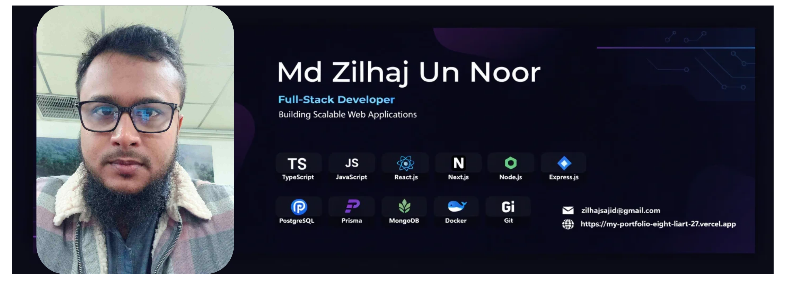

# Hi 👋, I'm Md. Zilhaj Un Noor

### Full-Stack Developer | Building Scalable Web Applications

I build modern, responsive web applications with a focus on clean architecture, secure APIs, and maintainable code. I'm continuously improving my skills by building real-world projects and exploring modern web technologies.

- 🔭 **Currently building:** Full-stack applications with React, Next.js, Node.js, and PostgreSQL.
- 🌱 **Currently learning:** Advanced TypeScript, Redux, software engineering best practices, and AI integration.
- 💻 **Specializing in:** REST APIs, authentication, role-based access control, database design, and payment integration.
- 🚀 **Interested in:** Scalable web applications, backend architecture, and AI-powered applications.
- 👯 **Open to:** Collaborating on meaningful full-stack projects and contributing to development teams.
- 📫 **Email:** [zilhajsajid@gmail.com](mailto:zilhajsajid@gmail.com)
- 🌐 **Portfolio:** [View My Portfolio](https://my-portfolio-eight-liart-27.vercel.app/)

---

### 🤝 Connect with Me

  
  
  
  

---

### 🛠️ Languages, Frameworks & Tools

#### Languages

  

#### Frontend Development

  

#### Backend Development

  

#### Databases & Authentication

  

#### Development Tools

  

---

### 🚀 Featured Projects

- **LifeLink BD** — A blood donation and emergency response platform with role-based access, blood request management, and payment integration.
- **RentNest** — A rental management application with authentication, role-based access control, and REST API development.
- **Prisma Press** — A blog backend featuring authentication, subscription management, and Stripe payment integration.

Explore more projects on my [GitHub profile](https://github.com/ZilhajSajid).

---

### ⚡ A Little About Me

I enjoy turning ideas into practical software, solving backend challenges, designing reliable APIs, and continuously learning technologies that help me become a better software engineer.

**Always learning. Always building. Always improving.**
